  

# 👋 Hi there

I'm a full-stack and backend engineer focused on architecting scalable cloud systems, building AI-driven applications, and designing end-to-end web and mobile solutions. Currently engineering backends at **Afriwork**.

I enjoy solving complex architectural challenges, optimizing distributed services, and crafting developer tooling with clean abstractions. When I'm not writing production code, you'll find me sharing technical insights on Medium or experimenting with modern AI workflows.

  

  

  

  

  

  

## 🚀 &nbsp;What I'm building

<table border="1" width="100%">
  <thead>
    <tr>
      <th width="32%" align="left"><h3>Project</h3></th>
      <th width="68%" align="left"><h3>What it does</h3></th>
    </tr>
  </thead>
  <tbody>
    <tr>
      <td valign="top">
        <h3><a href="https://github.com/estifz/Corestack">Corestack</a></h3>
      </td>
      <td valign="top">
        
<strong>Modular CLI scaffolder &amp; backend foundation</strong> for building scalable, secure, and fully-typed REST APIs with authentication and database presets.

      </td>
    </tr>
    <tr>
      <td valign="top">
        <h3><a href="https://github.com/estifz/cv-ranker">CVision</a></h3>
      </td>
      <td valign="top">
        
<strong>AI-powered resume screening platform</strong> that automatically parses and ranks candidates against job descriptions in real time to accelerate hiring.

      </td>
    </tr>
    <tr>
      <td valign="top">
        <h3><a href="https://github.com/estifz/Trailwatch">Trailwatch</a></h3>
      </td>
      <td valign="top">
        
<strong>Cinematic movie &amp; TV discovery web app</strong> featuring trailers, trending releases, and curated personalized recommendations in a modern UI.

      </td>
    </tr>
  </tbody>
</table>

&nbsp;

## ✍️ &nbsp;Recent Writing

<h4>
  • &nbsp;<a href="https://medium.com/@estif/vibe-coding-killed-the-dev-star-efd32f999cba" target="_blank" rel="noopener noreferrer">Vibe Coding Killed the Dev Star</a>  
  • &nbsp;<a href="https://medium.com/@estif/docker-vs-vms-why-developers-are-making-the-switch-0c9eeeaa9be0" target="_blank" rel="noopener noreferrer">Docker vs. VMs: Why Developers Are Making the Switch</a>  
  • &nbsp;<a href="https://medium.com/@estif/from-monolith-to-microservices-what-i-wish-i-knew-before-starting-1031a146d8a0" target="_blank" rel="noopener noreferrer">From Monolith to Microservices: What I Wish I Knew Before Starting</a>  
  • &nbsp;<a href="https://medium.com/@estif/no-kubernetes-isnt-magic-the-truth-about-how-pods-are-scheduled-409453713bb8" target="_blank" rel="noopener noreferrer">No, Kubernetes Isn't Magic: The Truth About How Pods Are Scheduled</a>  
  • &nbsp;<a href="https://medium.com/@estif/state-management-without-tears-understanding-redux-b53f74c20b82" target="_blank" rel="noopener noreferrer">State Management Without Tears: Understanding Redux</a>
</h4>

  <h4><a href="https://medium.com/@estif" target="_blank" rel="noopener noreferrer">Read more on Medium &rarr;</a></h4>

&nbsp;

## 🧰 &nbsp;My toolbox

&nbsp;

## 📊 &nbsp;Stats

